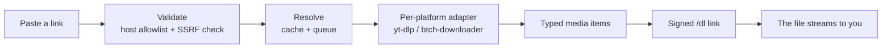

<div align="center">

# Snatcher

**Paste a link, keep the file.**

A media downloader for five platforms — Instagram, Facebook, TikTok,
Twitter/X and Pinterest — with one URL bar, real downloads, and batch mode.

[](https://nodejs.org)
[](https://github.com/mobeennasir/sakura-downloader)
[](https://github.com/mobeennasir/sakura-downloader)
[](https://www.koyeb.com)
[](https://github.com/mobeennasir/sakura-downloader)

</div>

Snatcher is a full rebuild of the old Sakura Downloader (v3.0.0): new name, new
Coral theme, new backend, new frontend, real downloads, and a test suite.

---

## What you get

- **Instagram** — reels and posts. A reel gives you its video; a post or
  carousel gives you every photo and video inside it, each with its own
  download button.
- **Pinterest** — pins, photos and videos in high quality. The photo/video
  switch filters the results; videos are converted from HLS to a real mp4.
- **TikTok, Facebook, Twitter/X** — paste a link, get the video.
- **Batch** — up to 10 links at once, one per line. Each link is checked on
  its own; one bad link never stops the rest.
- **Captions** — when a platform carries one (a tweet's text, a video
  description), it shows in a box under the downloads, with a Copy button.
  Instagram captions are not carried by its resolver, so none shows there.
- **Real downloads, with the real size** — files stream through a signed
  same-origin proxy (`/dl`), so the Download button actually downloads, and
  the browser shows the exact final size and progress from the start. Merged
  videos and HLS streams are buffered to disk first so their size is known
  too; the button says "Getting your file ready" while that happens.
- **Sensible filenames** — the caption's first words become the file name
  when a caption exists, so downloads never collide and never ask to
  "download again" — unless it really is the same file twice.
- **Logs** — development logs are colourised and multi-line; production logs
  are single-line and colourless, so a log viewer shows one event per line.
- **Error pages** — a different animated page per failure: "Lost in space."
  (404), "That link went nowhere.", "That one is locked.", "Too fast. Slow
  down.", "Took too long.", "Something broke on our side."

## Platforms

| Platform | What you get |
| --- | --- |
| Instagram | Reels, posts and carousels — every item inside |
| Pinterest | Pins, photos and videos in high quality |
| TikTok | The video |
| Facebook | The video |
| Twitter/X | The video, plus the tweet text as its caption |

## Theme — Coral

Light, warm grey paper, ink-board buttons, one deep-coral signal, 8px rounded
cards with a letterpress edge, General Sans + Geist Mono figures. The dark
Midnight theme was replaced because it read badly on real screens.

## Quick start

Requires Node.js 22+, ffmpeg, and the [yt-dlp](https://github.com/yt-dlp/yt-dlp)
binary on your PATH.

```bash
git clone https://github.com/mobeennasir/sakura-downloader.git
cd sakura-downloader
npm ci
cp .env.example .env   # optional; all settings have defaults
npm start              # http://localhost:3000
npm test               # vitest + supertest suite (112 tests)
```

## How it works



yt-dlp fetches Instagram and Facebook captions (and Pinterest media) from
a datacenter IP, which gets bot-checked without a logged-in session. Set
`YTDLP_COOKIES` (a Koyeb secret) to the contents of a Netscape cookies.txt
exported for instagram.com and/or facebook.com (Instagram `sessionid`,
Facebook `c_user` + `xs`), or `YTDLP_COOKIES_FILE` to a cookies.txt path
for local runs. The cookies are only ever handed to yt-dlp, never logged,
and `/health/ready` reports whether any are configured. Pinterest videos
arrive as HLS playlists, so the proxy converts them to mp4 with ffmpeg
instead of handing over a playlist file. TikTok is resolved by yt-dlp
directly, with btch-downloader as fallback — there is no third-party API
in the middle.

Every failure is one of eleven named errors (`src/errors.js`), each with its
own HTTP status, short message and animated error page. Connection failures
never leak as "Something broke on our side" — that message is reserved for
genuinely unknown errors, and those are logged server-side.

## Stack

Node.js 22 · Express 5 · EJS · yt-dlp · btch-downloader 6.4 · helmet ·
express-rate-limit · pino + pino-pretty · lru-cache · p-queue · vitest +
supertest.

<details>
<summary><strong>Configuration</strong></summary>

See `.env.example`. The important ones:

| Variable | Default | What it does |
| --- | --- | --- |
| `PORT` | `3000` | Port the server listens on |
| `YTDLP_PATH` | `yt-dlp` | Path to the yt-dlp binary |
| `DOWNLOAD_SECRET` | random per boot | Signs `/dl` URLs |
| `LOG_PRETTY` | pretty | `1` = colourised pino-pretty logs, `0` = raw JSON |
| `YTDLP_COOKIES` | — | Contents of a Netscape cookies.txt (Koyeb secret) |
| `YTDLP_COOKIES_FILE` | — | Path to a cookies.txt file (local runs) |
| `YTDLP_DOWNLOAD_TIMEOUT_MS` | `600000` | Timeout for a single download (10 min) |

</details>

## Deploy

Docker image (multi-stage, `node:22-alpine`, non-root, ffmpeg + yt-dlp
installed, healthcheck on `/health`):

```bash
docker build -t snatcher .
docker run -p 3000:3000 snatcher
```

On Koyeb, deploy from the public repo URL. Koyeb does not auto-deploy public
repos — after pushing, trigger the build manually in the Koyeb dashboard.

<details>
<summary><strong>Project structure</strong></summary>

```
server.js            Express app: routes, rate limit, helmet, signed /dl proxy
src/
  config.js          env config with defaults
  logger.js          pino + pino-pretty
  errors.js          one error taxonomy (code, status, message, error page)
  validate.js        host allowlist + SSRF/DNS checks
  download-links.js  HMAC signing + signed download URL builders
  yt-dlp.js          yt-dlp binary wrapper (info, streaming, client fallback)
  cache.js           LRU cache + in-flight coalescing + upstream queue
  media.js           the universal resolver: every platform → typed items
public/
  css/styles.css     Coral theme tokens, layout, error animations
  js/snatcher.js     one shared frontend module (fetch, results, batch, history)
  favicon.svg        white bolt on a deep-coral rounded square
  og.png             social preview image
views/
  home.ejs           hero URL bar + platform grid + recent links
  platform.ejs       one template for all five platforms
  error.ejs          animated error pages, one per error type
  maintenance.ejs    maintenance page
  partials/          head, header, footer, icons (inline SVG, no icon font)
tests/               vitest + supertest (run with `npm test`)
```

</details>

## Honest limits

- Instagram, TikTok and Facebook fetch from the platform's public pages.
  Whether they work depends on the server's IP: datacentre IPs get
  bot-checked or blocked, and private or login-walled posts never work.
  Failures surface as plain error messages, never as a fake success.
  A logged-in `YTDLP_COOKIES` session (Instagram `sessionid`, Facebook
  `c_user` + `xs`) is the reliable way past the caption bot-check (see above).
- Only download media you have the right to keep.

## License

ISC
